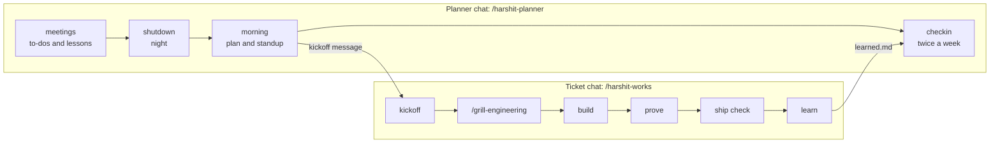

# skills

Agent skills for growing as an engineer while an AI writes most of the code.

AI agents make it easy to ship work you don't understand: the agent finds the
cause, picks the design, and writes the fix, and you approve it. These skills
flip that. **You** do the reasoning and make the decisions. The agent gathers
evidence, teaches, pushes back, and implements once you've decided. Every
ticket has two goals: ship it, and learn one thing from it.

```bash
npx skills add hrshtdotme/skills
```

## The skills

| Skill | Type it | What it does |
| --- | --- | --- |
| [`grill-engineering`](skills/grill-engineering/SKILL.md) | `/grill-engineering bug ENG-123 <the problem>` | An engineering interview. In `bug` mode the agent shows the evidence and asks questions until *you* name the root cause. In `feature` mode you choose the design from real options and trade-offs. `understand` mode walks you through a system that already exists. Every decision is recorded with its reason. |
| [`harshit-works`](skills/harshit-works/SKILL.md) | `/harshit-works active ENG-123 <the problem>` | The first message of every ticket session. It tells the agent how you work: you're the student and the decision maker, it's the mentor and implementer. It picks the workflow and tells you which command to type next. It loads no other skills. |
| [`harshit-planner`](skills/harshit-planner/SKILL.md) | `/harshit-planner` | Your daily routine in a separate chat. It plans the morning and runs a short shutdown at night. It reads your meeting transcripts for to-dos, decisions, expectations and lessons, and confirms each one with you before saving it. It drafts your standup, manager update and weekly goals, and runs twice-weekly check-ins that score your progress and improve these skills. |
| [`harshit-learn`](skills/harshit-learn/SKILL.md) | `/harshit-learn <system or ticket>` | Teaches a system as one map that never moves. A frame zooms from the whole system to each sub-system to each node, and you explain each step back before it goes deeper. It saves the map as a page you can step through, and ends with you drawing the map from memory. |

All four run only when you type them. They never start on their own, so one
skill's instructions never mix with another's.

## How they fit together



`/harshit-works` routes each ticket to one of three workflows:

| Workflow | When | Steps |
| --- | --- | --- |
| **Fix** | A bug or an incident | `/grill-engineering bug` → you decide the fix → build → prove → ship check → learn |
| **Build** | A feature | `/grill-with-docs` → `/grill-engineering feature` → `/to-spec` → `/to-tickets` → `/implement` → prove → ship check → learn |
| **Finish** | Review comments, rebases, decided work | You explain the decisions back in 3 sentences → build → prove → learn |

## Install

```bash
# all four skills
npx skills add hrshtdotme/skills

# just one
npx skills add hrshtdotme/skills --skill grill-engineering

# for your user instead of this project, into Claude Code only
npx skills add hrshtdotme/skills -g -a claude-code

# see what's in the repo
npx skills add hrshtdotme/skills --list
```

The Build workflow also uses `grill-with-docs`, `to-spec`, `to-tickets` and
`implement` from [mattpocock/skills](https://github.com/mattpocock/skills):

```bash
npx skills add mattpocock/skills --skill grill-with-docs to-spec to-tickets implement
```

Update later with `npx skills update`.

## Get started

1. In a new chat, run `/harshit-planner setup`. It creates `~/growth/` and
   asks about your goal, routine and tools: your tracker, where your repos
   live, your preview environment, your production branch.
2. Keep that chat as your planner. Each morning run `/harshit-planner`, and
   each night `/harshit-planner shutdown`. Shutdown reads the day's meetings
   first, from a meeting recorder connector such as Wispr Flow, or from notes
   you paste in.
3. Start every ticket in its own chat with
   `/harshit-works active <ticket-id> <the problem in your words>`.

`/grill-engineering` works on its own too, without the other two.

## Your growth folder

The skills keep everything in plain Markdown in `~/growth/`, so any chat can
pick up where the last one stopped:

```text
~/growth/
  me.md                 your goal, signals, routine and setup
  daily/YYYY-MM-DD.md   the day's plan, standup draft, evening review
  weekly/YYYY-Www.md    weekly goals and check-ins
  learned.md            one lesson per ticket, in your words
  glossary.md           technical terms: new → read → using
  skill-feedback.md     proposed and applied changes to the skills
  team.md               expectations, who owns what, shipping and risks
  meetings.md           meetings already processed
  tickets/<id>/         decisions.md for each ticket
  systems/<slug>.md     what you've learned of each system, step by step
  systems/<slug>/       its map: map.json, map.html, map.svg
```

## The ideas behind them

- **You answer before you see the agent's answer.** Seeing a recommendation
  first turns a decision into a rubber stamp.
- **Root cause, not symptom.** Every proposed cause goes through a why chain
  and a fix test: does fixing it make the failure impossible, or only rarer?
- **Evidence is marked proven or guessed**, with its source.
- **Diagrams at a labelled zoom level**: system, containers, components, or
  code and sequence (from the [C4 model](https://c4model.com/)). To learn a
  system, keep one map and move the focus, so every detail lands on a
  picture you already hold.
- **Words matter.** Each new term gets a one-line definition and a place in
  your glossary, until you use it on your own.
- **The work isn't done at merge.** Features ship with a usage signal and a
  failure signal, and you check both two days after release.
- **The skills get better through use.** Each session can propose one change;
  check-ins decide which ones to make.

## Customize

Your settings live in `~/growth/me.md`, not in the skills, so updates won't
overwrite them. To change how a skill behaves, fork this repository and edit
its `SKILL.md`. The `harshit-` names are mine; rename them in yours.

## Changelog

See [CHANGELOG.md](CHANGELOG.md).

## License

[MIT](LICENSE)
